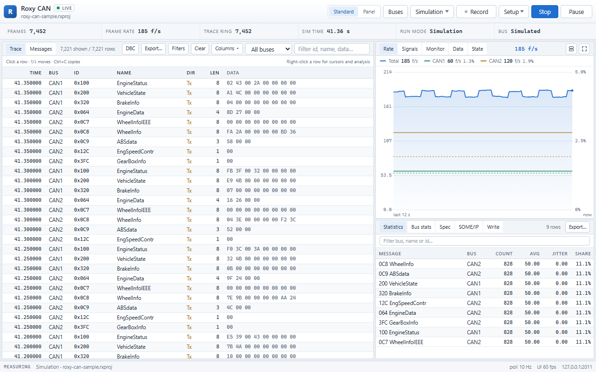
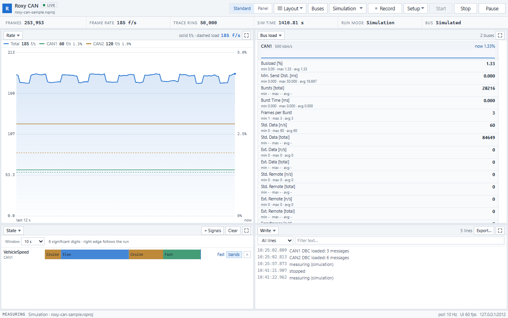
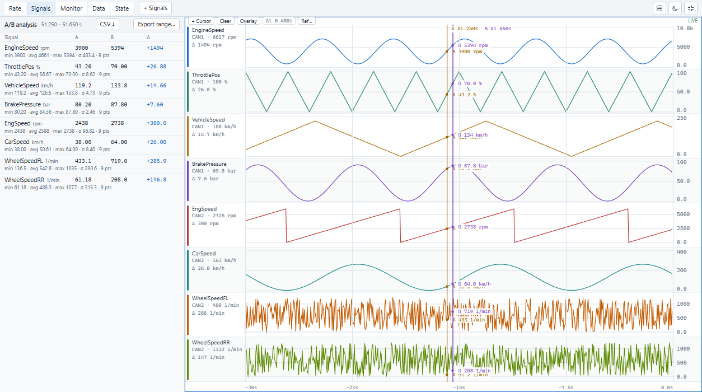
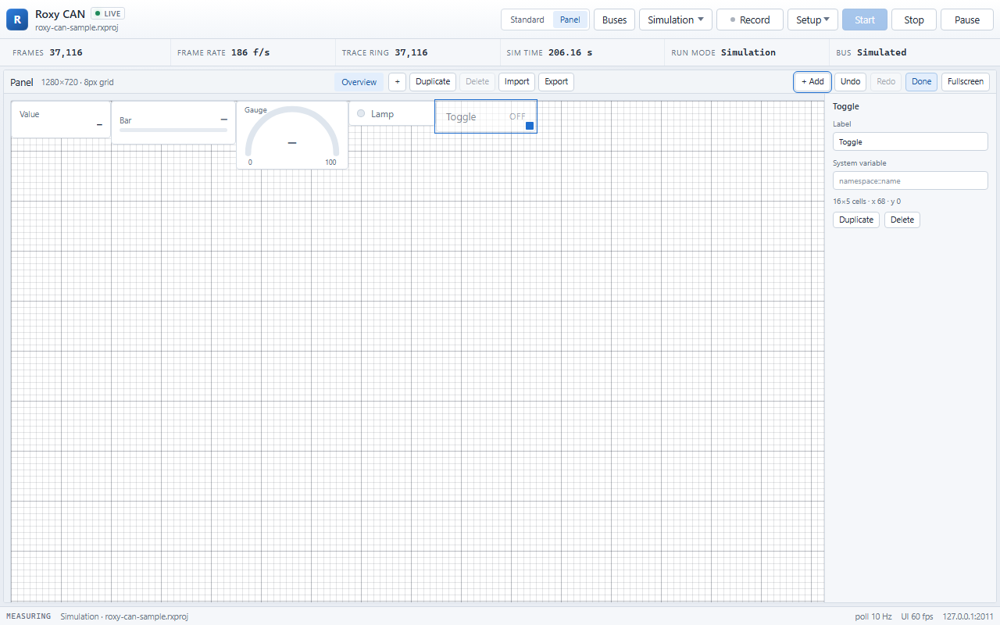

# roxy-can

基于 Rust 的 CAN / FlexRay / Ethernet 总线分析工具，使用本地 Web UI（axum + Preact，见 [web/README.md](web/README.md)）。多总线、每条总线各加载一份 DBC，覆盖经典 CAN、CAN FD、错误帧与远程帧，支持 Vector 硬件连接、与 Vector 工具链兼容的 ASC / BLF 录制与回放、经典 PCAP / PCAPNG 以太网抓包回放与 PCAP 录制，以及类 CAPL 的仿真节点脚本。Windows x64 可执行文件见 [Releases](https://github.com/chemPolonium/roxy-can/releases)。









截图使用浅色主题：首图是 Main + side（Signals / Monitor / Data），下表展示 Quad（Rate / Bus load / State / Write）和 Focus（曲线与 A/B 游标），最后是 Panel 操作页。

完整操作语义见 [docs/usage.md](docs/usage.md)，产品定位与体验准则见 [docs/product.md](docs/product.md)，这一页只说有什么。

## 功能

界面是固定的 Web 外壳：Standard 工作区提供 **Focus / Split / Main + side / Quad**
四种布局，每个槽位用页眉菜单选面板或移动；顶栏 **Standard / Panel** 切换操作页。
Trace / Messages / Rate / Signals / Monitor / Data / State / Messages stats / Bus load /
Spec / SOME/IP / Write 都是单实例页面，可放进任意槽位。入口与操作见
[web/README.md](web/README.md)。下文的“窗口”指 core 的观测模型，Web 用对应页面呈现。

- **动态总线**：数量不固定，在 Buses 窗口增删、改名，每条总线单独加载 DBC；删除总线时观测器、过滤器与生成器条目自动跟着重映射。
- **DBC 解码**：复用报文只解当前那一组；值表显示枚举文本；浮点信号按位模式解码并带类型标记。
- **帧模型**：经典 CAN、CAN FD（变长载荷至 64 字节、BRS / ESI）、错误帧、远程帧。Trace 的 Flags 列统一给帧类型，错误行与远程行有底色。
- **观测面板与布局**：Trace、Messages、Messages stats、Rate、Signals、Monitor、Data、State、Bus load、Spec、SOME/IP、Write 都是单实例页面，用页眉菜单放进 Focus / Split / Main + side / Quad 的任意槽位；选一个已在别处的面板会交换两个槽位，Move to 直接移动当前页。Trace/Messages 有独立过滤与选择；Data/Signals 可跨总线勾选信号，Signals 还支持 **Read**（只订阅、不画 lane，游标处读数），Messages 行可展开查看解码信号（按需解码）。
- **Panel 操作页**：顶栏 Standard / Panel 切换；多页面标签栏，每页独立画幅与控件；固定画布默认 1280×720、始终显示 8px 网格，Edit 下可新建/复制/重命名/删除页面并改画幅尺寸，用 **+ Add** 菜单添加 Button / Value / Bar / Gauge / Lamp / Toggle / Setpoint 控件，拖动/缩放吸附网格；Button 的 **On click** 二选一——**Send message**（发一条 CAN / FlexRay / Ethernet / SOME/IP 报文；已知帧可按物理值编码；SOME/IP 按 service/method 字段列表填值）或 **Script action**（`on panel_action("…")`，可带数值参数），Value 只读显示信号/派生/SysVar 并可按升序上限给数字分段染色，Bar / Gauge 按 min/max 填充并复用同一套色段，Lamp 在源值达到阈值时点亮（颜色可选），Toggle 写 SysVar 0/1，Setpoint 写 SysVar 或 DBC 信号并按所属后端的量程夹取；页面以 `.rxpanel` 文档存进工程文件，打开工程时自动合并回 Panel；也可单独 **Export** / **Import**（严格校验）。**Fullscreen** 覆盖应用外壳但保持浏览器窗口、画布居中不缩放。
- **Trace**：虚拟滚动（几十万行的过滤结果照样流畅），payload 字节搜索、信号值条件（`Name>10`）、精确地址（`id:1AB` / `slot:13`）、时间范围、列头排序、右键"Filter this ID"、行游标 A/B 与 Δt 读数、点一行选中后用 ↑/↓ 走行、Ctrl+C 复制；窄槽位自动隐藏低优先列。
- **总线负载与规格监视**：按总线给线上一帧占时加权的负载与帧率（1 s 滚动窗）、60 s 负载曲线、错误帧计数；Specification 把实测流量与数据库声明逐条对账——Unknown / Dlc / Cycle / Missing 四类判定，容差与宽限可调，可导出 CSV。
- **Interactive Generator（节点中心）**：DBC 报文按声明周期发送，按信号拖物理值或直接改 hex；每个信号可添加 Ramp / Sine / Step / Random / Triangle / Counter 激励。条目在 **Setup → Generator…** 里按总线编辑，行上标出所属 DBC 节点；新建默认不发送，发不发逐条由你决定。
- **触发器**：条件有信号越阈、ID 出现、错误帧、周期超时、FlexRay 帧到达、FlexRay 信号越阈、FlexRay 槽超时、系统变量越阈、CAN 载荷字节匹配、CAN E2E 计数器 gap/jump、以太网 flow 出现与 SOME/IP service 消息（可按 method / message type 收窄）；动作可开始/停止录制（带预触发上下文与 post-roll）、发反应帧（CAN / FlexRay / Ethernet 整条消息或 SOME/IP 消息；CAN 触发帧的同名信号自动镜像过去）、插入标记、清空 Trace、写系统变量或跑脚本动作。每条规则可设冷却、最大触发次数以及自己的 pre/post 录制帧数，行上单独 Re-arm；每次触发都进 Write 并可在回放条上用 Prev/Next trigger 跳转，Trace/曲线的右键菜单能就地建规则。规则可整表导出为 `.rxtriggers` 或从文件导入；导入按总线名重映射，逐条校验并报告跳过原因。
- **节点与脚本**：**Buses** 里每个 DBC 节点是模拟/离线开关（缺省离线）；**Setup → Generator…** 按总线列出条目并在行上标节点；**Setup → Scripts…** 新建或绑定节点脚本，编辑、应用与调试。
- **Profile 与硬件映射**：`profiles/<名>.toml` 存角色覆盖与硬件映射，配合 `--profile` 让同一份工程在仿真 / 台架 / CI 之间零修改切换；错配整份拒绝，绝不只生效一半。
- **Kvaser / Vector 硬件连接**：Buses 里选中总线、选硬件通道再点 **Attach**；通道被别的程序占用时自动降级为仅接收并在行上标注；CAN FD 按总线的数据段波特率申请，硬件不支持就降级经典并标注。连接期间收到的帧照常进入所有视图，真实节点不必被模拟。发送被线路拒绝不再是静默的：第一次写入 Write 窗口带驱动给的原因，之后只在 Buses 行上累计次数。
- **FlexRay**：可同时监听多路，每路一份自己的集群描述（FIBEX 2.x/3.x 或 AUTOSAR ARXML，中文编码无碍）。帧名与信号都按该路的描述解码，与 CAN 帧在 Trace 里按时间混排；Messages 逐帧给计数与周期均值±抖动，负载与规格照常判定；信号可订阅画曲线、进 State Tracker；帧到达与信号越阈都能作触发条件。**目前仅接收**：生成器条目与脚本发的 FlexRay 帧只进入本会话（所有视图与录制都看得见），但不出端口、不会被另一台设备收到。
- **车载以太网**：Buses 加载 AUTOSAR Ethernet 矩阵（ARXML）或 FIBEX 的 CHANNEL/FRAME/PDU/SIGNAL，没有 frame 的 PDU-only ARXML 也保留 PDU 与 endpoint 清单；Buses 的 **Live port…** 可把 Npcap 接口挂到 ETH 路，实时收帧、发帧；离线 PCAP/PCAPNG 与 BLF 的以太网帧按 VLAN/长度/EtherType 匹配帧定义并解码 PDU/I-Signal；录制时 ASC/BLF 与同名 `.eth.pcap` 同时留档，也可直接选 PCAP 格式只录 Ethernet；帧与 CAN/FlexRay 在 Trace 同表按时间混排，Messages stats 有 flow 行，信号可订阅画曲线；SOME/IP over UDP/TCP（含 Service Discovery）解码到 **SOME/IP** 页，分 Events / Services / Availability 查看 service/method/type/endpoint、ARXML 参数与 SD 可用性；Trace 导出 `.pcap`（MAC/VLAN/EtherType/载荷），ASC 导出负责 CAN/FlexRay。`FRAME-LENGTH 含 L2 头` 随工程保存。
- **统一 ARXML 导入**：Buses 的 `Import ARXML...` 一次读取文件里的全部 CAN / FlexRay / Ethernet cluster，各自建一路；CAN ARXML 读标识符/帧类、帧→PDU、I-Signal、compu/单位、PDU 周期与 ECU 端口发送方，和 DBC 共用同一套分析路径。
- **回放块**：依附于 DBC 节点——把该节点录制过的日志按 id 过滤后重新发到仿真总线上，按录制间距发送，仿真 restbus 的落地方案。
- **仿真节点**：类 CAPL 的小语言编译执行，`on start` / `on message` / `on fr slot` / `on timer` / `on errorFrame` 事件驱动，读写 DBC 信号、收发帧、随机与波形内建。每个回调有指令预算，有缺陷的脚本不会卡住总线，出错节点自动停止运行。可绑定到 DBC 节点，绑定后能否发送由该节点的角色决定。编辑器三栏：处理器大纲、静态收发事实表、函数与报文速插。语言参考见 [docs/script_language.md](docs/script_language.md)，可运行示例见 `examples/`。
- **派生信号**：脚本 `emit_value("名", 表达式)` 一行发布，像数据库信号一样进 Signals / Data / State。
- **系统变量**：CANoe 式的命名空间变量（初值 / 界限 / 单位 / 备注），专用窗口管理，脚本读写，同时发布为可观测流；每次测量开始复位为初值。
- **Monitor 监控面板**：轻量纯文本行，一行一个信号，行内阈值着色规则让"温度超 90 变红"这类告警一眼可见。
- **State Tracker**：对订阅信号的历史做状态分段——枚举标签、二进制方波、会话稳定配色，支持自定义区间与固定颜色，短区段按最短显示时长合并，区段表可导出 CSV。
- **Write 窗口**：整系统一条滚动输出——节点 `print`、装配层检查与告警、节点停止的错误、命令事件分色带时间戳；可按类别过滤、导出文本。
- **录制与回放**：读写 Vector ASC 与 BLF（经典 / FD / 错误 / 远程帧、FlexRay 收帧与 Ethernet 对象），录制时同时写 `.eth.pcap`，也可选 PCAP 格式只录 Ethernet；自家录的文件放回去是同一批帧；`--convert` 纯流式转码。播放器式控制——倍速增减、**Fast**（一次读到末尾）、按步长单步、播放指定时长或到指定时间后自动暂停（都只向前）；按时间戳顺序调度，不做进度条随机跳转。别人的日志只带通道编号，**Setup → Replay…** 里的 **Channel map** 把那些编号指到本工程的各路（CAN、FlexRay、以太网各一组，随工程保存）。录制支持按 id 过滤（CAN 写 hex、FlexRay 写 `FR0:13`）。
- **工程文件（.rxproj）**：总线与 DBC、观测窗口及过滤、信号选择、生成器配置、触发器、窗口布局全存一个 JSON；DBC 路径相对工程目录，工程文件夹可整体移动。
- **中文字体**：Web UI 跟随系统中文输入与显示。

## Web 快捷键

| 按键 | 功能 |
| --- | --- |
| F9 | 启动 / 停止测量 |
| Ctrl+S / Ctrl+Shift+S | 保存工程 / 另存为 |
| Ctrl+O | 打开工程（主机文件浏览器） |
| Ctrl+E | 导出 |
| Ctrl+K | 命令面板 |
| Ctrl+G | 跳到指定时刻 |
| ? | 快捷键与关于（输入框内不触发） |

## 构建与运行

需要 Rust 工具链（edition 2024）。Web UI 还需要先构建前端。

```sh
cd web && npm install && npm run build && cd ..
cargo run                       # Web UI, opens http://127.0.0.1:2010
```

运行测试：

```sh
cargo test
```

### Web UI

Web 版本在 `web/`，技术栈是 axum + Preact/Vite；这是唯一 UI，不再依赖
Dear ImGui 或 wgpu。

```sh
cd web && npm install && npm run build && cd ..
cargo run                                       # http://127.0.0.1:2010 演示仿真
cargo run -- --web --project <path.rxproj>      # 载入工程（停止状态）
cargo run -- --web --replay <path.asc|blf|pcap|pcapng> # 载入并开始回放
```

`cargo build --release` 产出的 exe 已内嵌前端资源，可以单独拷走运行。双击会
保留一个终端窗口，服务地址和启动失败原因都打印在那里；`--port <n>` 可换端口。
不带参数启动会在普通交互终端里自动打开默认浏览器；**以管理员身份运行、或输出被
重定向（脚本/代理运行、`cargo run > log`）时不会自动打开**——前者会启动管理员浏览器，
后者会打断浏览器的单实例握手，都会弹权限提示——按终端打印的地址手动打开即可。
`ROXY_WEB_NO_OPEN=1` 可完全关闭自动打开。

当前 Web 端已有：Trace / Messages 主视图（CAN、FlexRay、Ethernet 同行混排，方向、仅解码、Payload、时间范围、ID 包含/排除过滤，50k 行虚拟化）、总线速率/负载曲线、DBC 信号多泳道曲线与游标读数、Start/Stop/Pause；回放条（Speed 0.5x–Fast、Step 10ms–5s、Play for 1–60s、Play to 绝对时间，只向前）；品牌菜单的 **Open project… / Recent projects** 与 Ctrl+O 打开工程，**Save / Save as** 保存（保留工作区与 Signals 曲线配置，未保存有标记）；**Setup** 菜单里的 **Recording…**（ASC/BLF/PCAP、文件名模板与 `100, 3F4x, FR0:13` 白名单，写入工程旁 `Record/`）、**Replay…**（保存的日志文件夹、录制列表、Channel map）与 **Scripts…**（节点脚本的编辑、应用、日志、断点单步、断言）；**Buses…** 增删/改名/改速率/加载 DBC·FIBEX·ARXML，探测并挂载 Kvaser/Vector 通道、切换 Simulated/Real bus，每个 DBC 节点以 chip 切换 Simulated/Offline；**Setup → Generator…** 编辑 CAN/FlexRay 发送条目（On、周期、hex，CAN 另有 FD/BRS，一键模拟节点）与 **Replay blocks**，**Sources** 给 DBC 信号加波形（Ramp/Sine/Step/Random/Triangle/Counter）；**Triggers…** 与 **Variables…** 管理规则和系统变量；页眉菜单把 **Rate / Signals / Monitor / Data / State / Messages stats / Bus load / Spec / SOME/IP / Write** 放进四种布局的槽位；页眉的下载图标（Export）按扩展名导出 ASC/PCAP 与 CSV/TXT。观测覆盖 CAN、FlexRay 与 Ethernet；生成覆盖 CAN 与 FlexRay 会话帧（FlexRay 端口仍只收），Ethernet 可挂 Npcap 实时口收发，未挂口时 Panel/Trigger 只注入本会话。布局、信号选择、曲线与 Monitor/Data/State 行随工程保存。

## 上手

1. 品牌菜单 **Open project…**（Ctrl+O）打开工程，或 **Sample project** 生成示例；在 **Buses…** 里加总线、加载 DBC
2. 顶栏 **Run mode** 选 **Simulation** 或 **Replay** 后点 **▶**；Replay 先在 **Setup → Replay…** 勾选录制
3. **Buses…** 里把 DBC 节点切到 **Simulated**，在 **Setup → Generator…** 里逐条打开发送的报文、调数值、加激励
4. **Setup → Recording…** 配好文件名与格式，点顶栏 **Record** 开始/停止；**Save** 保存工程
5. **Spec** 页看实测流量与数据库声明的对账结果

## 命令行

脱离界面也能跑，适合放进 CI：

```sh
roxy-can --check-script <node.rxcan>            # 编译脚本，打印静态收发集与响应映射
roxy-can --project <p.rxproj> --duration 10 --stats out.csv   # 无头仿真整个工程
roxy-can --project <p.rxproj> --profile bench   # 叠加 profiles/bench.toml 的角色覆盖与硬件映射
roxy-can --convert <in.blf> <out.asc>           # 日志转码，保留 FlexRay 行
roxy-can --export-csv <in.blf> --dbc <a.dbc> --out signals.csv  # 按信号定义把日志导成 CSV
roxy-can --kvaser-probe                         # 列出 Kvaser 驱动可见的通道
roxy-can --vector-probe                         # 列出 Vector 通道，并逐口试开 FlexRay
roxy-can --vector-tx-probe 2                    # 打印该通道实际收到的驱动事件，用于核对发送结果
```

非零退出即失败。

## 文档

- [产品定位与体验准则](docs/product.md)：能力边界与改界面的取舍
- [使用说明](docs/usage.md)：每个窗口的操作语义与统计口径
- [节点脚本语言参考](docs/script_language.md)：完整的语言手册
- [架构文档](docs/architecture.md)：线程模型、命令/快照边界与开发约定
- [TODO.md](TODO.md)：还没做的事

## 主要依赖

- [axum](https://github.com/tokio-rs/axum) + [Preact](https://preactjs.com/)：本地 Web 宿主与前端
- [can-dbc](https://github.com/marcelbuesing/can-dbc)：DBC 解析
- [rfd](https://github.com/PolyMeilex/rfd)：原生文件对话框
- [memmap2](https://github.com/Razaek/memmap2-rs)：ASC/BLF 大文件流式读取
- [flate2](https://github.com/emoryns/rust-flate2)（rust_backend）：BLF zlib 容器解压

## 许可

GPL-3.0，详见 [LICENSE](LICENSE)。

