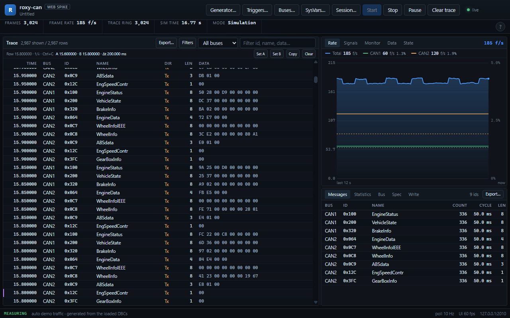

# roxy-can

基于 Rust 的 CAN / FlexRay 总线分析工具，使用本地 Web UI（axum + Preact，见 [web/README.md](web/README.md)）。多总线、每条总线各加载一份 DBC，覆盖经典 CAN、CAN FD、错误帧与远程帧，支持 Vector 硬件连接、与 Vector 工具链兼容的 ASC / BLF 录制与回放，以及类 CAPL 的仿真节点脚本。Windows x64 可执行文件见 [Releases](https://github.com/chemPolonium/roxy-can/releases)。



完整操作语义见 [docs/usage.md](docs/usage.md)，这一页只说有什么。

## 功能

界面是固定的 Web 外壳：Trace / Messages / Panel 主视图切换、右侧
Rate/Signals/Monitor/Data/State 标签页、下栏 Statistics/Bus/Spec/Write，
入口与操作见 [web/README.md](web/README.md)。下文的“窗口”指 core 的
观测模型，Web 用对应标签页呈现。

- **动态总线**：数量不固定，在 Buses 窗口增删、改名，每条总线单独加载 DBC；删除总线时观测器、过滤器与生成器条目自动跟着重映射。
- **DBC 解码**：复用报文只解当前那一组；值表显示枚举文本；浮点信号按位模式解码并带类型标记；信号量程与 `CM_` 注释进入目录，`VFrameFormat` 让短 CAN FD 帧也能标出来。
- **帧模型**：经典 CAN、CAN FD（变长载荷至 64 字节、BRS / ESI）、错误帧、远程帧。Trace 的 Flags 列统一给帧类型，错误行与远程行有底色。
- **观测面板**：Trace、Messages、Statistics、Signals、Data、State、Monitor 各有独立过滤与选择；Data/Signals 可跨总线勾选信号，Signals 还支持 **Read**（只订阅、不画 lane，游标处读数），Messages 行可展开查看解码信号（按需解码）。
- **Panel 操作页**：顶栏 Standard / Panel 切换；多页面标签栏，每页独立画幅与控件；固定画布默认 1280×720、始终显示 8px 网格，Edit 下可新建/复制/重命名/删除页面并改画幅尺寸，用 **+ Add** 菜单添加 Button / Value / Bar / Gauge / Lamp / Toggle / Setpoint 控件，拖动/缩放吸附网格；按钮的 **On click** 三选一：**Write signals**（只写一组 Signal writes 预设，逐项写入并汇总失败）、**Send message**（按一次发一条报文：CAN 先选 **Message**——Raw frame 手填总线/ID/扩展位，或选目录报文自动带出 ID——再填 hex 数据，可发 DBC 之外 ID；FlexRay 用总线/slot/hex 载荷，按描述补齐长度且只进本会话；Ethernet 选矩阵帧与 hex 载荷，长度须与帧声明一致、只进本会话；目录报文及 FR/ETH 已知帧可从 Raw 切到 Physical，按信号物理值编码），或脚本 `on panel_action("…", value)`（可选数值参数）；启动/停止/暂停等仿真控制只在顶部工具栏，不占用面板按钮，复杂逻辑写在脚本里，Value 只读显示信号/派生/SysVar 并可按升序上限给数字分段染色，Bar / Gauge 按 min/max 填充并复用同一套色段，Lamp 在源值达到阈值时点亮（颜色可选），Toggle 写 SysVar 0/1，Setpoint 的 **Target** 选 SysVar 或信号：SysVar 按 min/max 夹取，CAN/FlexRay/Ethernet 信号按目录声明的范围夹取并回读总线实际值（CAN 写进发送帧；FlexRay 与 Ethernet 只在本次测量内注入一帧，FlexRay 端口仍只收、Ethernet 没有发送端口；派生信号拒绝写入），两者都可带值触发脚本动作（旧的 Numeric/Setpoint 页面自动迁移）；页面可 **Export** 成 `.rxpanel` 或从文件 **Import** 成新页面（严格校验，不静默丢弃）；Edit 下右键控件、空白画布或页签分别打开上下文菜单（复制/删除、粘贴/添加/撤销、页面复制/导出/重命名）；**Fullscreen** 覆盖应用外壳但保持浏览器窗口、画布居中不缩放；页面随 Web workspace 保存。
- **Trace**：虚拟滚动（几十万行的过滤结果照样流畅），payload 字节搜索、信号值条件（`Name>10`）、精确地址（`id:1AB` / `slot:13`）、快速文本过滤支持 `id:`/`bus:`/`dir:`/`data:`/`name:` 与 `-` 排除、时间范围、列头排序、右键"Filter this ID"、行游标 A/B 与 Δt 读数、点一行选中后用 ↑/↓ 走行、Ctrl+C 复制；改过滤时选中行与视口位置不跳。
- **总线负载与规格监视**：按总线给线上一帧占时加权的负载与帧率（1 s 滚动窗）、60 s 负载曲线、错误帧计数；Specification 把实测流量与数据库声明逐条对账——Unknown / Dlc / Cycle / Missing 四类判定，容差与宽限可调，可导出 CSV。
- **Interactive Generator（节点中心）**：DBC 报文按声明周期发送，按信号拖物理值或直接改 hex；每个信号可添加 Ramp / Sine / Step / Random / Triangle / Counter 激励。条目在 **Generator…** 里按节点分组，新建默认不发送，发不发逐条由你决定。
- **触发器**：条件有信号越阈、ID 出现、错误帧、周期超时、FlexRay 帧到达、FlexRay 信号越阈、系统变量越阈；动作可开始/停止录制（带预触发上下文与 post-roll）、发反应帧（触发帧的同名信号自动镜像过去）、插入标记、清空 Trace。
- **节点角色**：Buses… 的 Nodes chip 把节点切成**模拟** / **离线**（缺省离线）；角色只决定"谁扮演"，发送仍逐条由条目开关决定。脚本节点、生成器条目与回放块三类驱动并存。
- **Profile 与硬件映射**：`profiles/<名>.toml` 存角色覆盖与硬件映射，配合 `--profile` 让同一份工程在仿真 / 台架 / CI 之间零修改切换；错配整份拒绝，绝不只生效一半。
- **Kvaser / Vector 硬件连接**：Buses… 选通道即连接；通道被别的程序占用时自动降级为仅接收并在行上标注；CAN FD 按总线的数据段波特率申请，硬件不支持就降级经典并标注。连接期间收到的帧照常进入所有视图，真实节点不必被模拟。发送被线路拒绝不再是静默的：第一次写入 Write 带驱动给的原因，之后只在 Buses 行上累计次数。
- **FlexRay**：可同时监听多路，每路一份自己的集群描述（FIBEX 2.x/3.x 或 AUTOSAR ARXML，中文编码无碍）。帧名与信号都按该路的描述解码，与 CAN 帧在 Trace 里按时间混排；Messages 逐帧给计数与周期均值±抖动，负载与规格照常判定；信号可订阅画曲线、进 State Tracker；帧到达与信号越阈都能作触发条件。**目前仅接收**：生成器条目、脚本与 Panel Setpoint 发的 FlexRay 帧只进入本会话（所有视图与录制都看得见），但不出端口、不会被另一台设备收到。
- **车载以太网**：Buses 加载 AUTOSAR Ethernet 矩阵（ARXML），离线 BLF 的以太网帧按 VLAN/长度/EtherType 匹配帧定义并解码 PDU/I-Signal；帧与 CAN/FlexRay 在 Trace 同表按时间混排，Messages/Statistics 有 flow 行，信号可订阅画曲线；Panel Setpoint 可写 Ethernet 信号，但只注入本会话（合成 MAC、矩阵 VLAN、EtherType 或无声明时 0x88B5），没有发送端口；Trace 导出 `.pcap`（MAC/VLAN/EtherType/载荷），ASC 导出负责 CAN/FlexRay。`FRAME-LENGTH 含 L2 头` 随工程保存。
- **统一 ARXML 导入**：Buses 的 `Import ARXML...` 一次读取文件里的全部 CAN / FlexRay / Ethernet cluster，各自建一路；CAN ARXML 读标识符/帧类、帧→PDU、I-Signal、compu/单位与物理量程、PDU 周期、ECU 端口发送方和 `SW-BASE-TYPE` 的符号/浮点编码；FlexRay 的 `COMPU-METHOD` 限值也换算成物理量程。和 DBC 共用同一套分析路径，只读不写回。
- **回放块**：依附于 DBC 节点——把该节点录制过的日志按 id 过滤后重新发到仿真总线上，按录制间距发送，仿真 restbus 的落地方案。
- **仿真节点**：类 CAPL 的小语言编译执行，`on start` / `on message` / `on fr slot` / `on timer` / `on errorFrame` 事件驱动，读写 DBC 信号、收发帧、随机与波形内建。`frame(Bus.Frame)` 可创建多个独立帧实例，写物理信号字段后用 `send_frame` 一次发一帧（CAN 走节点总线，FR/ETH 只进本会话）。每个回调有指令预算，有缺陷的脚本不会卡住总线，出错节点自动停止运行。可绑定到 DBC 节点，绑定后能否发送由该节点的角色决定。编辑器三栏：处理器大纲、静态收发事实表、函数与报文速插。语言参考见 [docs/script_language.md](docs/script_language.md)，可运行示例见 `examples/`。
- **派生信号**：脚本 `emit_value("名", 表达式)` 一行发布，像数据库信号一样进 Signals / Data / State Tracker。
- **系统变量**：CANoe 式的命名空间变量（初值 / 界限 / 单位 / 备注），专用窗口管理，脚本读写，同时发布为可观测流；每次测量开始复位为初值。
- **Monitor 监控面板**：轻量纯文本行，一行一个信号，行内阈值着色规则让"温度超 90 变红"这类告警一眼可见。
- **State Tracker**：对订阅信号的历史做状态分段——枚举标签、二进制方波、会话稳定配色，支持自定义区间与固定颜色，短区段按最短显示时长合并，区段表可导出 CSV。
- **Write 窗口**：整系统一条滚动输出——节点 `print`、装配层检查与告警、节点停止的错误、命令事件分色带时间戳；可按类别过滤、导出文本。
- **录制与回放**：读写 Vector ASC 与 BLF（经典 / FD / 错误 / 远程帧，以及 FlexRay 收帧），自家录的文件放回去是同一批帧；`--convert` 纯流式转码。播放器式控制——倍速增减、as-fast-as-possible、按步长单步、播放指定时长或到指定时间后自动暂停（都只向前）；按时间戳顺序调度，不做进度条随机跳转。别人的日志只带通道编号，Buses 窗口底部的**回放通道映射**把那些编号指到本工程的各路（CAN、FlexRay、以太网各一张表，随工程保存）。录制支持按 id 过滤（CAN 写 hex、FlexRay 写 `FR0:13`）。
- **工程文件（.rxproj）**：总线与 DBC、观测窗口及过滤、信号选择、生成器配置、触发器、窗口布局全存一个 JSON；DBC 路径相对工程目录，工程文件夹可整体移动。
- **中文字体**：Web UI 跟随系统中文输入与显示。

## Web 快捷键

| 按键 | 功能 |
| --- | --- |
| F9 | 启动 / 停止测量 |
| Ctrl+S | 保存工程 |
| Ctrl+Shift+S / Ctrl+O | 打开 Session 对话框 |
| Ctrl+E | 导出 |
| ? | 快捷键与关于（输入框内不触发） |

## 构建与运行

需要 Rust 工具链（edition 2024）。Web UI 还需要先构建前端。

```sh
cd web && npm install && npm run build && cd ..
cargo run                       # Web UI, opens http://127.0.0.1:2010
```

运行测试：

```sh
cargo test
```

### Web UI

Web 版本在 `web/`，技术栈是 axum + Preact/Vite；这是唯一的 UI。

```sh
cd web && npm install && npm run build && cd ..
cargo run                                       # http://127.0.0.1:2010 演示仿真
cargo run -- --web --project <path.rxproj>      # 载入工程（停止状态）
cargo run -- --web --replay <path.asc|blf>      # 载入并开始回放
```

`cargo build --release` 产出的 exe 已内嵌前端资源，可以单独拷走运行。双击会
保留一个终端窗口，服务地址和启动失败原因都打印在那里；`--port <n>` 可换端口。

界面是固定外壳：主视图 **Trace / Messages / Panel**，右侧
**Rate / Signals / Monitor / Data / State**，下栏
**Statistics / Bus / Spec / Write**。**Session…** 切换工程/回放（文件可在浏览器里选）；
**Buses…** 管总线、DBC/FIBEX/ARXML、通道与节点角色；**Generator… / Triggers… /
SysVars…** 编辑发送条目、触发器与系统变量；**Scripts…** 编辑、调试并运行节点脚本
（行断点、局部/全局变量、`on stop` + `test()` 结果）；**Export…** 导出 ASC/PCAP 与
各表 CSV。回放载入后出现第二工具栏（播放头、Speed、Step、Play for/to）。信号选择
覆盖 CAN、FlexRay 与 Ethernet，Monitor/Data/State 行与曲线选择随工程保存；硬件挂载
与浏览器文件交换都已接上。完整交互见 [web/README.md](web/README.md)。

## 上手

1. `cargo run` 启动演示仿真（或 **Session…** 载入工程/回放），顶栏 Start/Stop/Pause/Clear 控制测量。
2. **Buses…** 加载 DBC 或 ARXML、连接 Kvaser/Vector 通道，并把 DBC 节点切成**模拟**或**离线**。
3. **Generator…** 打开要发的报文并调周期/载荷/**Sources** 波形；**Triggers…** 配条件和动作；**SysVars…** 建变量。
4. Trace / Messages 看流量与解码；Signals 里勾信号画曲线，**Read** 只订阅读数。
5. 顶栏切到 **Panel**，Edit 下用 **+ Add** 摆控件（Button/Value/Bar/Gauge/Lamp/Toggle/Setpoint），Done 后直接操作；页面可 Export/Import `.rxpanel`。
6. 下栏 **Statistics / Bus / Spec / Write** 看计量、负载、规格对账与日志。

## 命令行

脱离界面也能跑，适合放进 CI：

```sh
roxy-can --check-script <node.rxcan>            # 编译脚本，打印静态收发集与响应映射
roxy-can --project <p.rxproj> --duration 10 --stats out.csv   # 无头仿真整个工程
roxy-can --project <p.rxproj> --profile bench   # 叠加 profiles/bench.toml 的角色覆盖与硬件映射
roxy-can --convert <in.blf> <out.asc>           # 日志转码，保留 FlexRay 行
roxy-can --export-csv <in.blf> --dbc <a.dbc> --out signals.csv  # 按信号定义把日志导成 CSV
roxy-can --kvaser-probe                         # 列出 Kvaser 驱动可见的通道
roxy-can --vector-probe                         # 列出 Vector 通道，并逐口试开 FlexRay
roxy-can --vector-tx-probe 2                    # 打印该通道实际收到的驱动事件，用于核对发送结果
```

非零退出即失败。

## 文档

- [使用说明](docs/usage.md)：每个窗口的操作语义与统计口径
- [节点脚本语言参考](docs/script_language.md)：完整的语言手册
- [架构文档](docs/architecture.md)：线程模型、命令/快照边界与开发约定
- [路线建议](docs/roadmap.md)：定位取舍与脚本语言决策（建议，未立项）
- [TODO.md](TODO.md)：还没做的事

## 主要依赖

- [axum](https://github.com/tokio-rs/axum) + [Preact](https://preactjs.com/)：本地 Web 宿主与前端
- [can-dbc](https://github.com/marcelbuesing/can-dbc)：DBC 解析
- [rfd](https://github.com/PolyMeilex/rfd)：原生文件对话框
- [memmap2](https://github.com/Razaek/memmap2-rs)：ASC/BLF 大文件流式读取
- [flate2](https://github.com/emoryns/rust-flate2)（rust_backend）：BLF zlib 容器解压

## 许可

GPL-3.0，详见 [LICENSE](LICENSE)。
